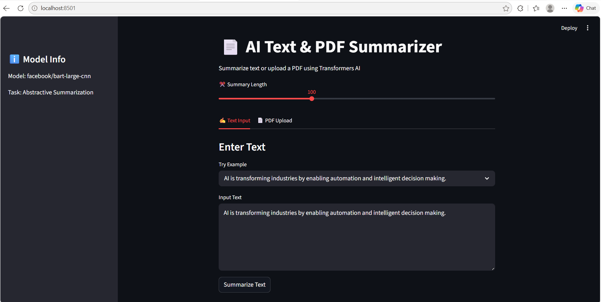
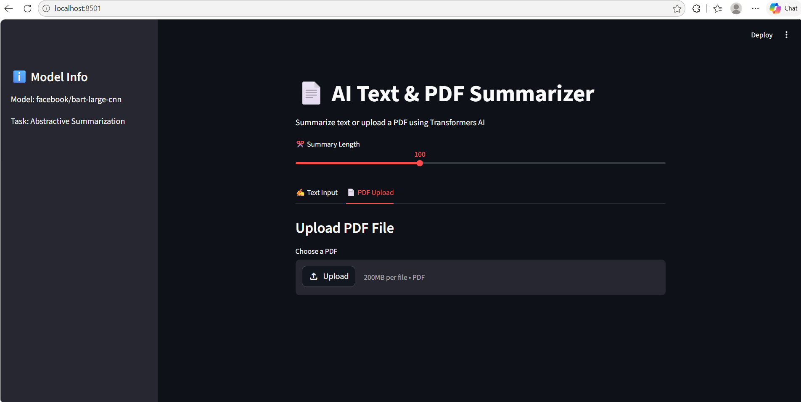
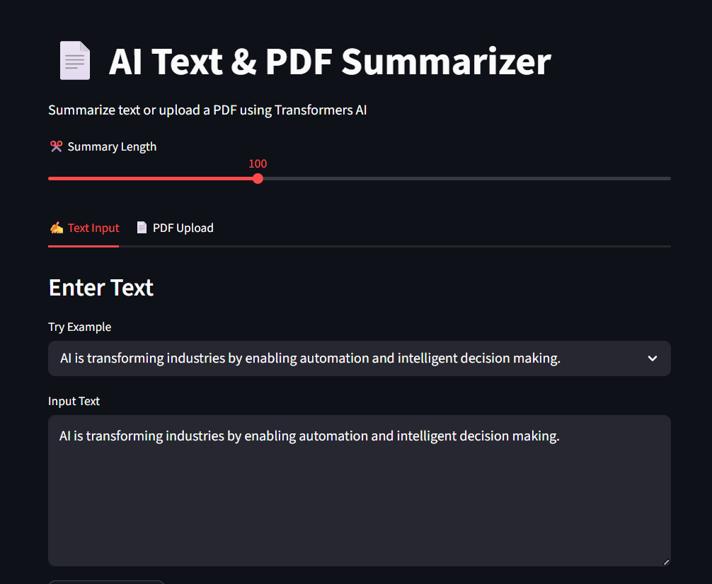

# AI Text & PDF Summarizer

An AI-powered web application that summarizes long text and PDF documents using state-of-the-art transformer models from Hugging Face. The application provides an intuitive Streamlit interface for generating concise summaries from user-provided text or uploaded PDF files.

---

## Features

* Summarize raw text input
* Extract and summarize PDF documents
* Text cleaning for PDF extraction issues (broken lines, hyphenation, extra spaces)
* Chunk-based summarization for long, multi-page documents
* Adjustable summary length
* Input vs. summary word count comparison
* Download generated summaries
* Interactive Streamlit web interface

---

## Technologies Used

* Python
* Streamlit
* Hugging Face Transformers
* PyPDF
* BART (`facebook/bart-large-cnn`)

---

## Model

The application uses **facebook/bart-large-cnn**, a transformer-based sequence-to-sequence model fine-tuned for abstractive text summarization.

---

## How It Works

1. **Input**: text is pasted in, or extracted page by page from an uploaded PDF using `pypdf`.
2. **Cleaning**: line breaks, words hyphenated across lines and repeated spaces are fixed.
3. **Chunking**: BART accepts at most 1024 tokens, so the text is split into chunks of whole sentences (about 600 words each).
4. **Summarization**: each chunk is summarized with BART; the partial summaries are combined and, if still longer than the selected length, summarized again.
5. **Output**: the final summary, word-count stats, number of chunks processed, and a download button.

The model is loaded once with `@st.cache_resource`, so it is not reloaded on every interaction.

---

## Project Structure

```
text_summarization_project/
│
├── app.py
├── requirements.txt
├── assets/
│   ├── text_input_ui.png
│   ├── pdf_input_ui.png
│   ├── text_output1.png
│   ├── text_output2.png
│   ├── pdf_output1.png
│   ├── pdf_output2.png
│   └── pdf_output3.png
└── README.md
```

---


## Live Demo

https://textsummarizationprojectfinl.streamlit.app/

---

## Screenshots

### Text Input



### PDF Upload



### Generated Summary



---

## Applications

* Research paper summarization
* Article summarization
* Study notes condensation
* Document review
* Educational content analysis

---

## Future Enhancements

* URL summarization
* Multi-language summarization
* Export summary as PDF
* OCR support for scanned PDFs

---

## Author

**Anushka Chavare**

GitHub: https://github.com/anushka-chavare

LinkedIn: https://www.linkedin.com/in/anushka-chavare/